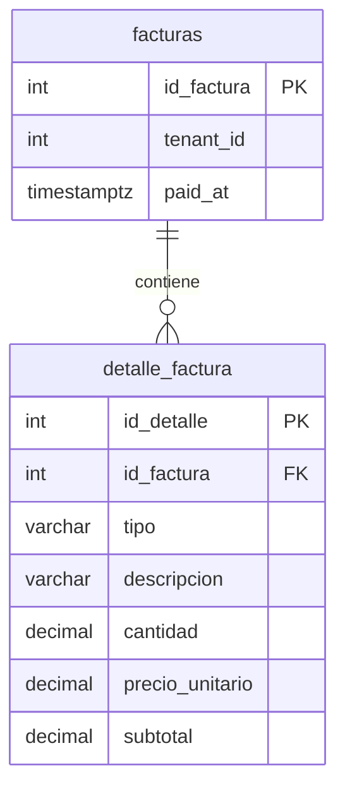

# BoxServices — Documentación de cambios

**Fecha:** 7 de noviembre de 2026.  
**Rama:** `dev-oscar-seguridad-facturacion-metricas`.  
**Alcance:** correcciones de seguridad, sesiones, permisos, facturación, métricas y experiencia de uso en backend y web.

## 1. Estado de la entrega

| Repositorio | Commit publicado | Contenido |
|---|---|---|
| BoxService_BackEnd | `6595801` | Seguridad por taller, validación de sesiones, detalle de facturas y métricas de cobro. |
| BoxService_FrontEnd | `9af5ecd` | Facturación directa, métricas, permisos visibles, mensajes de error y cargas animadas. |
| BoxService_Mobile | Sin cambios en esta entrega | No se implementaron ni publicaron estas mejoras en mobile. |

Los dos commits nuevos se publicaron en la rama indicada, conservando separados los cambios posteriores del PR anterior de Recordatorios. El destino acordado para los nuevos PR es `develop`. La aprobación, el merge y un eventual despliegue no se verificaron como parte de esta documentación.

Las migraciones **016 y 017 ya fueron ejecutadas manualmente por el usuario en Supabase** y sus estructuras se utilizaron en las pruebas. Los archivos SQL también quedaron incluidos en el commit del backend para reproducir el esquema en otras bases.

Este documento describe lo implementado y las comprobaciones realizadas. Cuando una función está confirmada por código pero no fue probada en vivo, se indica expresamente.

### Resumen para el equipo

- Se completaron controles que faltaban en algunas operaciones entre talleres; la separación por taller ya existía.
- Se comprueba la vigencia de las sesiones al procesar las peticiones autenticadas.
- Se permite facturar un service sin presupuesto previo, cargando sus conceptos y precios.
- Las nuevas facturas guardan sus propios conceptos, independientes del catálogo y del presupuesto.
- Se distingue lo facturado de lo cobrado y de lo pendiente.
- La web muestra errores comprensibles e indicadores animados durante cargas y acciones.

## 2. Separación de información entre talleres

### Problema anterior

Muchas consultas ya filtraban por taller. Sin embargo, algunas rutas de inspecciones y fotos recibían un identificador de service sin comprobar que perteneciera al taller del usuario. También faltaban controles sobre ciertas relaciones al crear registros.

Esto no implicaba que todas las pantallas mostraran datos mezclados: el problema estaba en operaciones concretas que podían intentarse directamente contra el backend, fuera de los controles visibles de la web.

### Cambios implementados

| Operación | Validación actual |
|---|---|
| Consultar, crear o actualizar una inspección | El service debe pertenecer al taller autenticado. |
| Subir una foto, obtener su enlace o eliminarla | Se comprueba el taller del service antes de ejecutar el manejador de la operación. |
| Crear un vehículo | El cliente debe existir, estar activo y pertenecer al mismo taller. |
| Crear un presupuesto | El vehículo debe pertenecer al taller autenticado. |
| Crear un service | El vehículo debe pertenecer al taller; si se indica sucursal, debe estar activa y pertenecer al mismo taller. |
| Vincular presupuesto y service | El presupuesto y el service deben ser del taller y corresponder al mismo vehículo. |
| Consultar presupuestos, services, facturas e historial por vehículo | Se exige explícitamente el identificador del taller en las consultas correspondientes. |
| Actualizar kilometraje al registrar un service | La actualización del vehículo también filtra por taller. |
| Armar listados con datos relacionados | Se refuerzan los cruces de tablas para que la relación coincida también en el taller. |

Las rutas de inspección se agruparon bajo `/services/{serviceId}/inspection`, con roles `dueno` y `empleado`, y comparten `TenantServiceFilter`. Este filtro usa `ITenantServiceAccess` / `TenantServiceAccess` para verificar la pertenencia del service.

Si el service es ajeno, el filtro devuelve **404 — “Service no encontrado.”** antes de consultar o modificar la inspección y antes de acceder a Storage. El mensaje no confirma al otro taller que el recurso exista.

### Rutas protegidas por el filtro

| Método | Ruta |
|---|---|
| GET | `/services/{serviceId}/inspection` |
| POST | `/services/{serviceId}/inspection` |
| PATCH | `/services/{serviceId}/inspection` |
| POST | `/services/{serviceId}/inspection/photos` |
| GET | `/services/{serviceId}/inspection/photos/{photoId}/url` |
| DELETE | `/services/{serviceId}/inspection/photos/{photoId}` |

### Fotografías y enlaces temporales

La aplicación obtiene enlaces firmados de Supabase con una vigencia informada de **900 segundos**. El control nuevo impide que otro taller solicite un enlace nuevo por el backend.

Un enlace firmado que ya fue emitido puede abrirse mientras siga vigente por quien lo posea. Cambiar de usuario en el navegador no revoca ese enlace. Por eso la prueba de aislamiento verificó la ruta que entrega el enlace, además de la consulta de la inspección.

Estos cambios son validaciones de aplicación; no se agregaron restricciones compuestas en la base para todas las relaciones entre talleres ni se repararon automáticamente posibles relaciones históricas incorrectas.

## 3. Sesiones y autenticación

El ingreso con usuario y contraseña y los JWT ya existían. La mejora consiste en comprobar que la autorización representada por el token siga vigente.

### Personal del taller y administrador

`SessionSecurity` verifica:

- Que el usuario exista y siga activo.
- Que su identificador, usuario, rol y taller coincidan con el token.
- Que el taller siga activo para dueños y empleados.
- Que la versión de credencial coincida con la contraseña actualmente registrada.
- Que el superadministrador conserve la configuración esperada, sin taller propio.

El JWT incorpora `credentialVersion`, una huella derivada del hash de contraseña. No incluye la contraseña ni el hash de contraseña original. Al cambiar la contraseña, cambia la huella esperada y los tokens anteriores dejan de superar la validación.

`SessionValidation.Validate` se conectó al evento `OnTokenValidated` de JWT en `Program.cs`. También se registró el servicio de comprobación de acceso del filtro de inspecciones. Estas son las dos incorporaciones de configuración realizadas en `Program.cs`.

### Comportamiento visible

1. Un empleado está conectado.
2. El dueño lo desactiva desde “Administración”.
3. Su siguiente consulta autenticada se rechaza con 401.
4. El cliente de API de la web solicita el cierre de sesión y redirige al login.

No se cierra una pantalla remota instantáneamente mediante notificaciones en tiempo real; el rechazo ocurre cuando se procesa una nueva petición.

**Importante:** desactivar rechaza el token mientras la cuenta permanezca inactiva. No se implementó una lista permanente de tokens revocados: si se reactiva la cuenta sin cambiar la contraseña y el token anterior todavía no venció, puede volver a cumplir las condiciones de validación. El navegador que ya cerró su sesión debe ingresar nuevamente.

Los tokens antiguos que no contienen la versión requerida necesitan reemplazarse iniciando sesión nuevamente.

### Portal del cliente existente

También se reforzó el portal ya implementado:

- Se comprueba que el cliente esté activo y que su taller siga activo.
- Se valida la versión del vínculo de Google mediante `portalSession`.
- La versión se obtiene del vínculo existente en `client_portal_access`.
- Renovar el acceso de invitación invalida la correspondencia con la sesión anterior.
- Las consultas de vehículos, presupuestos y services usan también el taller del cliente.
- Los presupuestos en estado `draft` no se incluyen en la respuesta del portal.
- Se quitó el registro en logs del token de invitación y del identificador de Google en el aviso modificado.

No se agregó en esta entrega un portal de solicitudes a varios talleres. El acceso real con Google y la renovación de invitaciones no se probaron en vivo durante esta ronda.

## 4. Roles y permisos

Los roles no se crearon nuevamente; se alinearon controles visibles y del backend en las áreas modificadas.

| Cuenta de prueba / concepto | Rol backend | Nombre utilizado en la web | Alcance relevante |
|---|---|---|---|
| `administrador` | `superadmin` | Superadmin | Administración global; no actúa como un taller operativo propio. |
| `tenant1`, `tenant2` | `dueno` | Dueño; internamente `owner` | Operaciones y administración de su taller. |
| `empleado1`, `empleado2` y empleado creado en el segundo taller | `empleado` | Empleado; internamente `employee` | Operaciones habilitadas de su propio taller. |
| Cliente del portal | `customer` | Portal del cliente | Sus vehículos y datos habilitados del portal existente. |

`tenant1` y `tenant2` son nombres de usuario de prueba, no nombres de roles.

### Ajustes de esta entrega

- **“Métricas”** queda restringido al dueño en la página y en `GET /metrics`.
- El empleado puede consultar **“Catálogo”**, pero la web no muestra formularios ni botones para crear, editar o borrar ítems.
- El backend ya restringía la escritura del catálogo; la interfaz se alineó con esa restricción. Se incorporó también el control correspondiente en el router mock.
- El dueño conserva la posibilidad de activar/desactivar a sus empleados y restablecer sus contraseñas; no es una facultad exclusiva del administrador global.

El listado titulado **“Empleados del taller”** también puede incluir al dueño. No se cambió ese título en estos commits. Los nombres de usuario de acceso siguen siendo únicos en todo el sistema; permitir el mismo usuario en distintos talleres requeriría cambiar cómo se identifica la cuenta al ingresar.

## 5. Presupuesto, service y factura

| Concepto | Significado en este circuito |
|---|---|
| Presupuesto | Propuesta con conceptos, cantidades y precios, que puede aprobarse y convertirse en trabajo realizado. |
| Service | Registro del trabajo realizado sobre un vehículo y parte de su historial. Puede existir sin presupuesto. |
| Factura | Comprobante del importe facturado por un service, con sus conceptos y su estado de cobro. |

### Problema anterior

Ya se podía registrar un service sin presupuesto. Al facturarlo, el importe se tomaba del presupuesto asociado; si no existía, el circuito podía emitir una factura por $0.

### Flujo A: service con presupuesto

1. Se utiliza el presupuesto asociado al service.
2. Debe estar finalizado (`completed`).
3. Debe corresponder al mismo service, vehículo y taller.
4. El backend obtiene sus conceptos, valida cantidades y precios y calcula el total.
5. La factura guarda una copia propia del detalle.

Si el cliente de la API omite `budgetId` pero el service ya tiene presupuesto vinculado, el backend lo busca. No permite reemplazar sus conceptos e importes enviando un detalle manual.

Los presupuestos finalizados no admiten el cambio de estado incorporado en esta corrección; la edición de detalle de presupuestos finalizados también está restringida por el circuito existente.

### Flujo B: service sin presupuesto

1. Desde “Taller”, se registra el service sobre el vehículo.
2. En la sección “Facturación” de la ficha se pulsa **“Facturar”**.
3. Se abre **“Facturar service sin presupuesto”**.
4. Se cargan conceptos manualmente o mediante **“Agregar del catálogo”**.
5. Se indican tipo, descripción, cantidad y precio unitario.
6. Se revisa el total y se pulsa **“Emitir factura”**.

No se crea un presupuesto artificial para completar este flujo.

Ejemplo probado manualmente:

| Concepto | Cantidad | Precio unitario | Subtotal |
|---|---:|---:|---:|
| Lámpara | 1 | $50.000 | $50.000 |
| Colocación de lámpara | 1 | $30.000 | $30.000 |
| **Total** | | | **$80.000** |

### Validaciones de importes

- Entre 1 y 100 conceptos por factura.
- Tipos admitidos: `labor` y `part`.
- Descripción no vacía, de hasta 200 caracteres después de recortar espacios.
- Cantidades positivas, con hasta dos decimales.
- Precios no negativos, con hasta dos decimales.
- Subtotales y total dentro del máximo de `99.999.999,99`.
- Total de la factura mayor a cero.
- Subtotales calculados en el servidor y redondeados a dos decimales con `MidpointRounding.AwayFromZero`.

La web muestra una vista previa. No se acepta un total o subtotal del navegador como fuente de verdad.

### Persistencia e impresión

La factura y sus renglones se insertan en una misma transacción. Si falla el guardado del detalle, no se confirma parcialmente la emisión.

La consulta individual de la factura devuelve sus conceptos mediante `InvoiceDto`. La impresión usa el detalle guardado con la factura. Cambiar un precio del catálogo después de emitirla no modifica ese detalle.

Las facturas históricas no reciben una copia inventada del detalle: si no tienen conceptos propios y tienen presupuesto asociado, la web utiliza ese presupuesto como respaldo para imprimir. No se corrigieron automáticamente facturas antiguas por $0.

### Prevención de duplicados

La interfaz deja de ofrecer “Facturar” cuando identifica una factura del service. Además, el backend comprueba que no exista otra factura y bloquea la fila del service con `FOR UPDATE` dentro de la transacción de emisión.

La prueba con dos emisiones concurrentes obtuvo una respuesta 201 y otra 400, con una única factura persistida.

La comprobación actual considera cualquier factura existente del service, incluso anulada. No se implementó un circuito para volver a facturar un service que ya tenga una factura anulada.

## 6. Cobros y Métricas

### Antes y después

Antes se sumaban las facturas no anuladas, incluidas las pendientes de pago. Ese valor representa facturación; no equivale a dinero efectivamente recibido.

Ahora la pantalla distingue:

| Tarjeta exacta de la interfaz | Criterio |
|---|---|
| “Total facturado este mes” | Total de facturas no anuladas emitidas en el mes actual. |
| “Total facturado este año” | Total de facturas no anuladas emitidas en el año actual. |
| “Cobrado este mes” | Total de facturas en `paid` cuya fecha `paid_at` cae en el mes actual. |
| “Cobrado este año” | Total de facturas en `paid` cuya fecha `paid_at` cae en el año actual. |
| “Pendiente de cobro (total)” | Total actual de facturas en `issued`, sin limitarlo al mes de emisión. |

Ejemplo: se emiten dos facturas de $50.000 en octubre y se cobra una ese mes. Octubre muestra $100.000 facturados, $50.000 cobrados y $50.000 pendientes. Si la segunda se registra como cobrada en noviembre, suma al cobrado de noviembre; la facturación de octubre sigue siendo $100.000.

### Qué representa `paid_at`

Al pasar de `issued` a `paid`, el backend guarda `NOW()` en `paid_at`. Repetir el cambio a `paid` no vuelve a reemplazar la fecha.

**Es el momento en que se registra el cobro con “Cobrar”.** No hay un campo para ingresar o corregir una fecha histórica. Si el taller cobra un día y registra la acción otro día, el sistema usa el día del registro. La factura impresa continúa mostrando la fecha de emisión; no se agregó allí la fecha de cobro.

Anular una factura conserva el dato de cobro existente, pero la factura queda fuera de las sumas de facturación y cobros. Los límites del mes y año de cobros se calculan según el calendario de Argentina, convirtiendo esos límites a UTC para consultar `TIMESTAMPTZ`.

### Datos históricos

Las facturas ya cobradas, pero sin `paid_at`, no se asignan a un mes inventado. La pantalla informa su importe con el aviso **“facturas cobradas sin fecha registrada”** y no lo suma a los cobros del mes o año.

### Gráfico y rankings

- **“Facturación por mes”** sigue mostrando lo facturado, tanto cobrado como pendiente, excluyendo anuladas.
- La consulta comienza en el inicio del mes actual menos cinco meses y agrupa los meses que tienen facturas. No rellena meses vacíos con cero ni ofrece un selector de períodos.
- El SQL de ese gráfico no establece un límite superior; registros con fecha futura, si se cargan por otra vía, también podrían aparecer.
- No se agregó un gráfico de cobros por mes: los cobros nuevos se muestran en las tarjetas del mes y año actuales.
- **“Ítems de trabajos realizados por importe”** y **“Servicios más pedidos”** siguen tomando los renglones de presupuestos completados. No representan cobros ni incorporan los conceptos de la facturación directa sin presupuesto.
- **“Ticket promedio este mes”** corresponde al promedio de las facturas no anuladas emitidas en el mes.

Los campos anteriores `revenueThisMonth`, `revenueThisYear` y `revenueByMonth` conservan su significado de facturado. Se agregaron `collectedThisMonth`, `collectedThisYear`, `pendingCollectionTotal` y `paidWithoutDateTotal`. Las mutaciones de facturas invalidan también las consultas de Métricas para actualizar la pantalla.

No se implementaron pagos parciales: **“Cobrar” marca la factura completa como cobrada**.

## 7. Cambios en Supabase

### Migración 016 — fecha de cobro

Agrega `paid_at TIMESTAMPTZ`, opcional y sin valor por defecto, a `public.facturas`. Crea `idx_facturas_tenant_paid_at` sobre `(tenant_id, paid_at)`, únicamente para filas en `estado = 'paid'`.

No cambia importes, no borra facturas y no completa fechas históricas. La fecha se completa desde el backend al registrar el cobro.

### Migración 017 — detalle propio de la factura

Crea `public.detalle_factura`:

| Columna | Tipo | Función / restricción |
|---|---|---|
| `id_detalle` | SERIAL | Clave primaria de cada renglón. |
| `id_factura` | INT | Clave foránea a `facturas(id_factura)`, obligatoria. |
| `tipo` | VARCHAR(20) | `labor` o `part`. |
| `descripcion` | VARCHAR(200) | Descripción obligatoria, no vacía. |
| `cantidad` | DECIMAL(10,2) | Mayor a cero. |
| `precio_unitario` | DECIMAL(10,2) | Mayor o igual a cero. |
| `subtotal` | DECIMAL(10,2) | Mayor o igual a cero. |



Una factura puede tener varios renglones. `ON DELETE CASCADE` significa que una eliminación física de la factura eliminaría también sus renglones; **anular** una factura solo cambia su estado y no borra su detalle.

Se crea `idx_detalle_factura_factura` para buscar por factura. La tabla no tiene un `tenant_id` propio: el acceso del backend se filtra uniendo el detalle con la factura y comprobando el taller de esta.

Las restricciones de la tabla no comprueban por sí solas todas las fórmulas de importes. La validación y el cálculo de cantidades, precios, subtotales y total se hacen en el backend.

### RLS

La migración activa Row Level Security en `detalle_factura` y no agrega políticas para los roles normales de la API de datos de Supabase. Sin esas políticas, `anon` y `authenticated` no obtienen acceso directo a las filas.

El backend usa su conexión PostgreSQL configurada y necesita permisos suficientes para acceder. El filtrado por taller del backend sigue siendo necesario: activar RLS no reemplaza esos controles y los roles privilegiados de base pueden omitir RLS según sus permisos.

### Cómo se aplican las migraciones

En esta sesión se ejecutaron únicamente las consultas 016 y 017, manualmente en SQL Editor, por decisión del usuario. No hace falta agregarlas otra vez a la base utilizada para estas pruebas.

El comando existente del proyecto:

```powershell
dotnet run -- migrate
```

procesa **todos** los archivos `Database/migrations/*.sql` en orden contra la base configurada y termina sin iniciar el servidor. No selecciona únicamente 016 y 017. Iniciar normalmente con `dotnet run` no aplica estas migraciones, salvo que se indique una opción de preparación explícita.

`IF NOT EXISTS` evita volver a crear los objetos si ya existen; no comprueba que un objeto previo tenga exactamente el esquema esperado. Los comentarios de un SQL tampoco impiden que el ejecutor lo procese.

El ejecutor actual informa errores por archivo y continúa. Debe revisarse la salida completa: un mensaje final de proceso completado no demuestra por sí solo que todas las migraciones hayan tenido éxito.

## 8. Mensajes de error en la web

### Problema anterior

Algunas vistas interpretaban “no recibí los datos” como “todavía estoy cargando”, incluso después de un error. En la factura de otro taller, por ejemplo, el backend devolvía 404, pero la pantalla permanecía en “Cargando…”.

### Componentes comunes

| Archivo | Responsabilidad |
|---|---|
| `ErrorState.tsx` | Tarjeta de error con estado, título, explicación y navegación o reintento según el caso. |
| `Alert.tsx` | Mensajes de resultado de acciones, con roles accesibles de alerta o estado. |
| `error-messages.ts` | Mensajes comunes de API y traducciones de validaciones seleccionadas. |
| `app/error.tsx` | Recuperación de errores de renderizado de pantalla mediante “Reintentar”. |
| `app/not-found.tsx` | Presentación común de página no encontrada. |

### Estados contemplados

| Código / situación | Presentación relevante |
|---|---|
| 400 | “El enlace o los datos no son válidos”. |
| 401 | “Tu sesión dejó de estar vigente”; el cliente de API solicita logout y navega al login. |
| 403 | “No tenés permiso para acceder”. |
| 404 | Información no encontrada o sin acceso; se personaliza según la vista. |
| 503 | “No pudimos conectar con el servidor”, con reintento. |
| Otros fallos de consulta | “No se pudo completar la consulta”, con reintento. |
| Respuesta que no contiene JSON válido | Se transforma en error de API controlado en lugar de mostrar el error de parseo. |

En la factura se muestra **“Factura no encontrada o sin acceso”** y **“Volver a Facturas”**. En inspección se utiliza **“Inspección no encontrada o sin acceso”** y **“Volver a Taller”**.

Los errores 403/404 no ofrecen reintentos que simulen que cambiará un permiso o aparecerá un recurso por insistir. Los casos recuperables permiten reintentar. Los mensajes 500 se normalizan para no presentar el detalle interno devuelto por el servidor. Las traducciones de validaciones son una lista seleccionada, no una traducción exhaustiva de todos los posibles mensajes existentes del backend.

### Inspección nueva frente a acceso denegado

La web ya no asume que todo 404 de inspección significa que corresponde crearla. Ante ese resultado consulta si el service sigue accesible:

- Service accesible, sin inspección: ofrece el editor para crearla.
- Service no accesible o inexistente: presenta el estado de error.
- Consulta fallida por otra causa: muestra el error y la opción de reintentar correspondiente.

Esto evita ofrecer el formulario de inspección de un service ajeno. La autorización efectiva se mantiene en el backend.

### Cliente HTTP y proxy

`web/lib/api/client.ts` distingue fallos de red, estados HTTP y respuestas no válidas. Conserva un código de error que las pantallas usan para decidir la presentación. El proxy de Next.js devuelve una respuesta JSON 503 controlada si falla la conexión con el backend.

La política común de consultas no reintenta automáticamente los errores HTTP 4xx. Otros fallos admiten un reintento de consulta según la configuración general; algunas consultas establecen explícitamente `retry: false`. Esto no agrega reintentos automáticos de operaciones de escritura.

## 9. Cargas animadas y acciones en curso

### Componentes y comportamiento

| Elemento | Comportamiento |
|---|---|
| `Spinner` | Ícono giratorio reutilizable; queda estático si el usuario prefiere reducir movimiento. |
| `LoadingState` | Indicador con texto, por ejemplo “Cargando inspección…”. |
| `Button` | Acepta `loading` y `loadingText`, muestra el spinner y se deshabilita durante la operación. |
| `NetworkActivity` | Aviso global: “Actualizando datos…” o “Procesando acción…”, para actividad de React Query. |
| `app/loading.tsx` | Indicador al abrir una pantalla mientras se resuelve su segmento de navegación. |

El botón también detecta promesas devueltas por su `onClick`, conserva el estado ocupado hasta que terminan y usa un bloqueo inmediato para evitar el segundo clic antes del siguiente renderizado. Si una acción asíncrona no maneja su rechazo, muestra una explicación genérica junto al botón.

Los formularios que se envían por `onSubmit` utilizan sus estados explícitos de envío. El indicador de “Registrar nuevo service” se mantiene durante todo el proceso de creación del service y guardado de su detalle, no solo durante la primera petición.

El bloqueo del botón es una protección de interfaz; no reemplaza la validación del backend ante peticiones duplicadas o enviadas por otra vía.

### Pantallas alcanzadas

- Ingreso de personal y componentes de ingreso al portal con Google.
- Clientes y vehículos, incluida la búsqueda y las opciones de catálogo de vehículos.
- Taller: resumen, búsqueda, historial, presupuestos, services, facturación e inspección/fotos.
- Presupuestos, facturas y sus vistas de impresión; ticket de trabajo.
- Catálogo y Métricas.
- Recordatorios.
- Administración del taller y pantallas de talleres, usuarios y pagos del administrador.
- Cierre de sesión y controles compartidos de acciones.

Si falla un catálogo opcional de conceptos, el formulario informa el problema y mantiene la posibilidad de cargar conceptos manuales. La barra lateral conserva navegación y cierre de sesión aunque falle su consulta del contador de Recordatorios.

### Accesibilidad

- Errores con `role="alert"`.
- Estados de carga y éxito con `role="status"` y anuncios apropiados.
- Botones ocupados con `aria-busy` y texto complementario para lectores de pantalla.
- Spinner decorativo oculto al lector para evitar anuncios duplicados.
- Respeto de `prefers-reduced-motion`.
- Aviso global de actividad oculto durante impresión.

No se incorporaron porcentajes ficticios de avance: los indicadores señalan actividad, no un progreso medido.

## 10. Pruebas realizadas y su alcance

| Verificación | Resultado | Evidencia / alcance |
|---|---|---|
| Compilación backend | Correcta | `dotnet build`, ejecutado por el usuario. |
| Pruebas unitarias xUnit | 19 aprobadas | Proyecto de pruebas incorporado desde `develop`; no son 19 pruebas creadas en esta entrega. |
| Reglas de sesiones y facturación | 56 comprobaciones aprobadas | `scripts/Test-TenantBillingSecurity.ps1`; no conecta a Supabase. |
| Integración directa con backend en ejecución | 27 comprobaciones aprobadas | Ejecutor auxiliar de esta sesión, con registros nuevos identificados como QA. |
| Feedback de interfaz | 20 comprobaciones aprobadas | Errores de API simulados, marcado accesible y comportamiento de bloqueo del botón. Sin conexión a Supabase. |
| Lint frontend | 0 errores, 6 advertencias | Se conservaron las advertencias previas. |
| TypeScript y build frontend final | Correctos | Build de producción de Next.js con las rutas generadas. |

Las cuatro cifras de pruebas no deben sumarse para presentar una única suite homogénea: corresponden a herramientas y alcances distintos.

### Pruebas manuales confirmadas por el usuario

- Service sin presupuesto, carga de conceptos e importe de $80.000.
- Emisión, cobro y actualización visible de las tarjetas de Métricas.
- Consulta/impresión de la factura con sus dos conceptos.
- Facturación desde presupuesto.
- Ausencia del botón para volver a facturar un service ya facturado.
- Catálogo sin acciones de escritura y menú sin Métricas para el empleado.
- Listados del segundo taller sin datos del primero, antes de crear los datos de prueba.
- Factura ajena por enlace directo rechazada con 404 y mensaje visual correcto.
- Inspección propia y apertura de su foto funcionando.
- Consultas de inspección y enlace de foto ajenas rechazadas con 404.
- Empleado desactivado que pierde acceso en la siguiente consulta.
- Cambio de contraseña efectuado por el usuario que invalida la sesión anterior.
- Aspecto de los nuevos mensajes y estados de carga revisado por el usuario.

Para comprobar dos sesiones se usaron una ventana normal y una de incógnito. Dos pestañas normales comparten las cookies; no sirven para mantener al dueño y al empleado conectados como cuentas independientes.

### Pruebas directas del backend

Se validaron sesiones temporales con las condiciones actuales de dos dueños en talleres distintos, sin modificar contraseñas. Estas pruebas usan autenticación JWT válida para ejercitar los endpoints; no reproducen el ingreso por formulario.

Se comprobaron rechazos al consultar, crear o guardar inspecciones ajenas, subir fotos, obtener enlaces de fotos, crear vehículos con clientes ajenos, crear services o presupuestos con vehículos ajenos, vincular un presupuesto propio con un service ajeno y facturar un service ajeno.

Para la ruta DELETE se verificó primero que el identificador de foto utilizado no existiera. El resultado fue el error del filtro **“Service no encontrado.”**, antes de buscar la foto. **No se eliminó una foto real ni se ensayó su borrado efectivo.** Esta comprobación confirma el rechazo por taller de esa ruta con ese identificador; no debe describirse como una eliminación real revertida.

Se emitió una factura válida de prueba, se rechazó una segunda emisión y se verificó que quedara una sola fila. También se enviaron dos emisiones simultáneas sobre otro service nuevo: una se aceptó, la otra se rechazó y se confirmó una única factura persistida.

Se verificó que los intentos rechazados no hubieran creado vehículos, services o presupuestos adicionales y que la factura original 18 y la inspección original 42 conservaran sus datos.

### Registro de datos QA conservados

Por instrucción del usuario, no se borraron datos ni fotos. Se conservaron registros identificados con **`QA-52de0afc03`**:

| Elemento | Identificadores / estado |
|---|---|
| Clientes | 29 y 30. |
| Vehículos | 37 y 38. |
| Services | 49 y 50. |
| Presupuesto | 32, dejado en estado `rejected` al terminar la prueba. |
| Fotografía | Imagen de prueba conservada, vinculada a la inspección QA. |
| Facturas | Dos facturas de prueba conservadas en estado `cancelled`. |

La primera preparación fue rechazada por kilometraje cero; se continuó reutilizando el cliente y vehículo ya creados y usando un kilometraje válido. No quedó un segundo juego de esos datos por ese intento.

Las facturas anuladas no suman en los importes de facturación/cobro. Los clientes y services QA sí pueden incrementar sus contadores; las secuencias de numeración consumidas no se restablecieron.

Los ejecutores auxiliares de integración y feedback quedaron fuera de los repositorios. El script de 56 comprobaciones sí está incluido en el backend. No se está entregando una suite de integración nueva instalada en CI como parte de estos commits.

### Advertencias y comprobaciones pendientes

Las seis advertencias de lint corresponden a imports/variables sin usar, una limitación de optimización de React Hook Form y una recomendación de navegación en el cliente de API. El build advierte también sobre dos archivos `package-lock.json`; no impidió compilar y no se corrigió en esta entrega.

No se verificaron en vivo: desactivar un taller entero, cambios de rol/taller de una cuenta, acceso Google del portal, renovación de invitaciones ni una matriz exhaustiva de todas las rutas y roles. Varias reglas relacionadas están confirmadas por código y pruebas locales, pero eso no reemplaza sus pruebas de integración particulares.

## 11. Integración y compatibilidad

1. Los PR nuevos se comparan contra `develop` desde `dev-oscar-seguridad-facturacion-metricas`, uno por repositorio.
2. La rama parte de `dev-oscar` y conserva commits del trabajo previo de Recordatorios. Mientras ese PR no esté integrado, pueden aparecer en la comparación. Debe revisarse el diff luego de integrarlo.
3. La estructura de base de 016/017 debe existir antes de usar el backend nuevo para las operaciones que la consultan.
4. En la base de esta sesión ya existe porque se aplicó manualmente. En otra base debe aplicarse de forma coordinada con el código.
5. Frontend y backend deben integrarse de forma coordinada: el frontend utiliza campos y detalle agregados por el backend.
6. Se requiere iniciar sesión nuevamente para reemplazar JWT anteriores sin la versión de credencial.
7. Después de integrar, conviene repetir un recorrido breve en el entorno de destino con cuentas de prueba y verificar los permisos de la conexión PostgreSQL.

Mobile no recibió cambios. Los campos anteriores de facturación se conservaron, pero eso no demuestra compatibilidad completa: los tokens anteriores deben renovarse y el acceso de empleados a Métricas ahora es rechazado. Las etiquetas, funcionalidades de facturación y estados visuales de mobile requieren una revisión propia del compañero responsable.

La documentación previa `backend/docs/CORRECCIONES_TENANTS_Y_COBROS.md` quedó incluida en el commit, pero su apartado de preparación conserva notas redactadas antes de la ejecución manual y de la aclaración del mecanismo de migraciones. Para el estado efectivo de la base y el comportamiento del ejecutor, prevalece lo explicado en este documento. No se modificó ese archivo nuevamente al preparar este informe.

## 12. Antecedente: corrección del PR de Recordatorios

En el commit anterior **`3d45dd5`**, sobre `dev-oscar`, se corrigió `015_crear_service_reminder_contacts.sql`:

- Se agregó `IF NOT EXISTS` al `CREATE TABLE` de `service_reminder_contacts`.
- Se agregó `IF NOT EXISTS` al índice por taller.
- Se retiró el comentario que indicaba ejecución manual obligatoria en Supabase.
- El archivo quedó siguiendo el estilo revisado, sin `BEGIN` / `COMMIT` explícitos.

La tabla conserva `id_service` como PK y FK a `services`; también tiene FK de `tenant_id` a `tenants`, fecha y usuario de contacto. Ya existían la tabla y el índice en el diseño: esta corrección evitó intentar recrearlos cuando ya estuvieran presentes.

La funcionalidad original de Recordatorios, realizada previamente, permite consultar los próximos servicios y vencidos, abrir WhatsApp con un mensaje preparado y registrar manualmente el contacto. No representa envío automático ni implementación de SMS. En el nuevo commit del frontend la pantalla de Recordatorios recibió el mismo feedback de carga/error que las otras pantallas.

El estado actual de aprobación o merge del PR anterior no se consultó en GitHub al generar este informe.

## 13. Límites funcionales que permanecen

- No hay pagos parciales ni elección de una fecha pasada al cobrar.
- No se reconstruyen fechas de cobro o detalles históricos que no estaban guardados.
- La fecha de cobro no se agregó a la factura impresa.
- No hay selector de meses ni gráfico histórico de cobros.
- Los rankings de trabajos no incorporan los conceptos de facturas directas.
- No se agregó reemisión para un service con factura anulada.
- Los enlaces firmados ya entregados conservan su vigencia temporal.
- No existe revocación permanente por token para desactivación/reactivación de usuarios.
- El bloqueo de botones no ofrece idempotencia general para toda operación del sistema; la protección contra facturas duplicadas también existe en el servidor.
- No se probó una eliminación efectiva de foto y no se borraron los registros QA.
- No se implementó el circuito de solicitudes de presupuesto a varios talleres ni se actualizó mobile.

## 14. Inventario completo de archivos de los commits nuevos

Los siguientes inventarios se obtienen de los commits publicados. “Nuevo” significa incorporado por ese commit; “Modificado” significa que el archivo ya existía. Los enlaces apuntan a la revisión exacta para que el equipo pueda compartirlos sin depender de las rutas locales.

### BoxService_BackEnd — 31 archivos

| Archivo | Estado | Cambio |
|---|---|---|
| [Api/BudgetEndpoints.cs](https://github.com/maxi-gartner/BoxService_BackEnd/blob/6595801701de96e1a874db82535fb64a365d8c00/Api/BudgetEndpoints.cs) | Modificado | Pasa el taller a la consulta de presupuestos por vehículo. |
| [Api/InvoiceEndpoints.cs](https://github.com/maxi-gartner/BoxService_BackEnd/blob/6595801701de96e1a874db82535fb64a365d8c00/Api/InvoiceEndpoints.cs) | Modificado | Pasa el taller a la consulta de facturas por vehículo. |
| [Api/MetricsEndpoints.cs](https://github.com/maxi-gartner/BoxService_BackEnd/blob/6595801701de96e1a874db82535fb64a365d8c00/Api/MetricsEndpoints.cs) | Modificado | Restringe GET /metrics al rol dueno. |
| [Api/PortalEndpoints.cs](https://github.com/maxi-gartner/BoxService_BackEnd/blob/6595801701de96e1a874db82535fb64a365d8c00/Api/PortalEndpoints.cs) | Modificado | Filtra por taller y omite presupuestos en borrador en el portal. |
| [Api/ServiceEndpoints.cs](https://github.com/maxi-gartner/BoxService_BackEnd/blob/6595801701de96e1a874db82535fb64a365d8c00/Api/ServiceEndpoints.cs) | Modificado | Pasa el taller al listado de services del vehículo. |
| [Api/ServiceInspectionEndpoints.cs](https://github.com/maxi-gartner/BoxService_BackEnd/blob/6595801701de96e1a874db82535fb64a365d8c00/Api/ServiceInspectionEndpoints.cs) | Modificado | Agrupa las seis rutas y aplica roles y filtro de pertenencia. |
| [Api/TenantServiceFilter.cs](https://github.com/maxi-gartner/BoxService_BackEnd/blob/6595801701de96e1a874db82535fb64a365d8c00/Api/TenantServiceFilter.cs) | Nuevo | Filtro compartido y servicio de comprobación de pertenencia del service. |
| [Api/VehicleEndpoints.cs](https://github.com/maxi-gartner/BoxService_BackEnd/blob/6595801701de96e1a874db82535fb64a365d8c00/Api/VehicleEndpoints.cs) | Modificado | Consulta el historial con el taller explícito. |
| [Auth/AuthService.cs](https://github.com/maxi-gartner/BoxService_BackEnd/blob/6595801701de96e1a874db82535fb64a365d8c00/Auth/AuthService.cs) | Modificado | Comprueba taller activo al ingresar y emite la versión de credencial. |
| [Auth/PortalAuthService.cs](https://github.com/maxi-gartner/BoxService_BackEnd/blob/6595801701de96e1a874db82535fb64a365d8c00/Auth/PortalAuthService.cs) | Modificado | Valida el acceso vigente, agrega portalSession y evita registrar el token de invitación. |
| [Auth/SessionSecurity.cs](https://github.com/maxi-gartner/BoxService_BackEnd/blob/6595801701de96e1a874db82535fb64a365d8c00/Auth/SessionSecurity.cs) | Nuevo | Reglas de vigencia del usuario, taller, rol y versión de contraseña. |
| [Auth/SessionValidation.cs](https://github.com/maxi-gartner/BoxService_BackEnd/blob/6595801701de96e1a874db82535fb64a365d8c00/Auth/SessionValidation.cs) | Nuevo | Comprobación de sesión de personal y portal después de validar el JWT. |
| [DTOs/InvoiceDto.cs](https://github.com/maxi-gartner/BoxService_BackEnd/blob/6595801701de96e1a874db82535fb64a365d8c00/DTOs/InvoiceDto.cs) | Modificado | Incluye el detalle propio de la factura en el contrato de respuesta. |
| [Database/migrations/016_fecha_cobro_facturas.sql](https://github.com/maxi-gartner/BoxService_BackEnd/blob/6595801701de96e1a874db82535fb64a365d8c00/Database/migrations/016_fecha_cobro_facturas.sql) | Nuevo | Agrega paid_at y su índice parcial por taller. |
| [Database/migrations/017_crear_detalle_factura.sql](https://github.com/maxi-gartner/BoxService_BackEnd/blob/6595801701de96e1a874db82535fb64a365d8c00/Database/migrations/017_crear_detalle_factura.sql) | Nuevo | Crea detalle_factura, su relación con facturas, índice y RLS. |
| [Models/Invoice.cs](https://github.com/maxi-gartner/BoxService_BackEnd/blob/6595801701de96e1a874db82535fb64a365d8c00/Models/Invoice.cs) | Modificado | Modelos de conceptos de factura y detalle opcional en la solicitud de emisión. |
| [Models/TenantMetrics.cs](https://github.com/maxi-gartner/BoxService_BackEnd/blob/6595801701de96e1a874db82535fb64a365d8c00/Models/TenantMetrics.cs) | Modificado | Campos nuevos de cobrado, pendiente e histórico sin fecha. |
| [Program.cs](https://github.com/maxi-gartner/BoxService_BackEnd/blob/6595801701de96e1a874db82535fb64a365d8c00/Program.cs) | Modificado | Conecta la validación de sesión JWT y registra el servicio usado por el filtro. |
| [Repositories/BudgetRepository.cs](https://github.com/maxi-gartner/BoxService_BackEnd/blob/6595801701de96e1a874db82535fb64a365d8c00/Repositories/BudgetRepository.cs) | Modificado | Agrega filtros de taller a consultas y relaciones del presupuesto. |
| [Repositories/InvoiceRepository.cs](https://github.com/maxi-gartner/BoxService_BackEnd/blob/6595801701de96e1a874db82535fb64a365d8c00/Repositories/InvoiceRepository.cs) | Modificado | Consulta/guarda detalles, registra cobro y protege la emisión transaccional contra duplicados. |
| [Repositories/MetricsRepository.cs](https://github.com/maxi-gartner/BoxService_BackEnd/blob/6595801701de96e1a874db82535fb64a365d8c00/Repositories/MetricsRepository.cs) | Modificado | Calcula cobros por fecha de registro, pendiente e histórico sin fecha. |
| [Repositories/PortalAccessRepository.cs](https://github.com/maxi-gartner/BoxService_BackEnd/blob/6595801701de96e1a874db82535fb64a365d8c00/Repositories/PortalAccessRepository.cs) | Modificado | Obtiene la versión del vínculo de acceso del portal. |
| [Repositories/ServicesRepository.cs](https://github.com/maxi-gartner/BoxService_BackEnd/blob/6595801701de96e1a874db82535fb64a365d8c00/Repositories/ServicesRepository.cs) | Modificado | Filtra el historial y la actualización de kilometraje por taller. |
| [Repositories/VehicleRepository.cs](https://github.com/maxi-gartner/BoxService_BackEnd/blob/6595801701de96e1a874db82535fb64a365d8c00/Repositories/VehicleRepository.cs) | Modificado | Exige coincidencia de taller al relacionar vehículo y cliente en el listado. |
| [Services/BudgetService.cs](https://github.com/maxi-gartner/BoxService_BackEnd/blob/6595801701de96e1a874db82535fb64a365d8c00/Services/BudgetService.cs) | Modificado | Valida vehículo y service del taller y bloquea cambios de estado de presupuestos finalizados. |
| [Services/InvoiceRules.cs](https://github.com/maxi-gartner/BoxService_BackEnd/blob/6595801701de96e1a874db82535fb64a365d8c00/Services/InvoiceRules.cs) | Nuevo | Valida conceptos/importes y relación con presupuesto; calcula límites temporales de cobros. |
| [Services/InvoiceService.cs](https://github.com/maxi-gartner/BoxService_BackEnd/blob/6595801701de96e1a874db82535fb64a365d8c00/Services/InvoiceService.cs) | Modificado | Admite facturación directa, conserva presupuesto cuando existe y calcula el detalle en servidor. |
| [Services/ServicesService.cs](https://github.com/maxi-gartner/BoxService_BackEnd/blob/6595801701de96e1a874db82535fb64a365d8c00/Services/ServicesService.cs) | Modificado | Exige vehículo propio y sucursal propia activa cuando se informa. |
| [Services/VehicleService.cs](https://github.com/maxi-gartner/BoxService_BackEnd/blob/6595801701de96e1a874db82535fb64a365d8c00/Services/VehicleService.cs) | Modificado | Exige cliente activo del mismo taller al crear vehículo. |
| [docs/CORRECCIONES_TENANTS_Y_COBROS.md](https://github.com/maxi-gartner/BoxService_BackEnd/blob/6595801701de96e1a874db82535fb64a365d8c00/docs/CORRECCIONES_TENANTS_Y_COBROS.md) | Nuevo | Documentación técnica inicial y guía de comprobación; preparación anterior al estado descrito aquí. |
| [scripts/Test-TenantBillingSecurity.ps1](https://github.com/maxi-gartner/BoxService_BackEnd/blob/6595801701de96e1a874db82535fb64a365d8c00/scripts/Test-TenantBillingSecurity.ps1) | Nuevo | Ejecutor local de 56 comprobaciones sin base de datos. |

### BoxService_FrontEnd — 48 archivos

| Archivo | Estado | Cambio |
|---|---|---|
| [web/app/(auth)/login/page.tsx](https://github.com/maxi-gartner/BoxService_FrontEnd/blob/9af5ecd5148b37f8d8caccefa40ff61ca0eedcc3/web/app/%28auth%29/login/page.tsx) | Modificado | Indicador de envío e ingreso/navegación en curso. |
| [web/app/(dashboard)/admin/pagos/page.tsx](https://github.com/maxi-gartner/BoxService_FrontEnd/blob/9af5ecd5148b37f8d8caccefa40ff61ca0eedcc3/web/app/%28dashboard%29/admin/pagos/page.tsx) | Modificado | Errores y cargas de consulta; feedback al registrar un pago. |
| [web/app/(dashboard)/admin/tenants/page.tsx](https://github.com/maxi-gartner/BoxService_FrontEnd/blob/9af5ecd5148b37f8d8caccefa40ff61ca0eedcc3/web/app/%28dashboard%29/admin/tenants/page.tsx) | Modificado | Errores y cargas en talleres, creación y acciones. |
| [web/app/(dashboard)/admin/usuarios/page.tsx](https://github.com/maxi-gartner/BoxService_FrontEnd/blob/9af5ecd5148b37f8d8caccefa40ff61ca0eedcc3/web/app/%28dashboard%29/admin/usuarios/page.tsx) | Modificado | Errores y cargas de usuarios/clientes; acciones con feedback. |
| [web/app/(dashboard)/catalogo/page.tsx](https://github.com/maxi-gartner/BoxService_FrontEnd/blob/9af5ecd5148b37f8d8caccefa40ff61ca0eedcc3/web/app/%28dashboard%29/catalogo/page.tsx) | Modificado | Control de acceso en servidor y delegación al panel con permiso de edición. |
| [web/app/(dashboard)/clientes/page.tsx](https://github.com/maxi-gartner/BoxService_FrontEnd/blob/9af5ecd5148b37f8d8caccefa40ff61ca0eedcc3/web/app/%28dashboard%29/clientes/page.tsx) | Modificado | Estados de consultas/envío y animación de invitación al portal. |
| [web/app/(dashboard)/facturas/page.tsx](https://github.com/maxi-gartner/BoxService_FrontEnd/blob/9af5ecd5148b37f8d8caccefa40ff61ca0eedcc3/web/app/%28dashboard%29/facturas/page.tsx) | Modificado | Errores y cargas del listado/resumen y acciones de cobro/anulación. |
| [web/app/(dashboard)/metricas/page.tsx](https://github.com/maxi-gartner/BoxService_FrontEnd/blob/9af5ecd5148b37f8d8caccefa40ff61ca0eedcc3/web/app/%28dashboard%29/metricas/page.tsx) | Modificado | Restringe la página al dueño y delega la visualización al dashboard. |
| [web/app/(dashboard)/presupuestos/page.tsx](https://github.com/maxi-gartner/BoxService_FrontEnd/blob/9af5ecd5148b37f8d8caccefa40ff61ca0eedcc3/web/app/%28dashboard%29/presupuestos/page.tsx) | Modificado | Estados de listado, detalle y edición; botones ocupados. |
| [web/app/(dashboard)/recordatorios/page.tsx](https://github.com/maxi-gartner/BoxService_FrontEnd/blob/9af5ecd5148b37f8d8caccefa40ff61ca0eedcc3/web/app/%28dashboard%29/recordatorios/page.tsx) | Modificado | Estados comunes de carga/error y feedback de acciones. |
| [web/app/(dashboard)/taller/page.tsx](https://github.com/maxi-gartner/BoxService_FrontEnd/blob/9af5ecd5148b37f8d8caccefa40ff61ca0eedcc3/web/app/%28dashboard%29/taller/page.tsx) | Modificado | Estado de deep-link del vehículo, rechazo de ID inválido y carga de navegación. |
| [web/app/(dashboard)/vehiculos/page.tsx](https://github.com/maxi-gartner/BoxService_FrontEnd/blob/9af5ecd5148b37f8d8caccefa40ff61ca0eedcc3/web/app/%28dashboard%29/vehiculos/page.tsx) | Modificado | Errores y cargas de consultas/guardado y aviso del catálogo externo con alternativa manual. |
| [web/app/api/proxy/[...path]/route.ts](https://github.com/maxi-gartner/BoxService_FrontEnd/blob/9af5ecd5148b37f8d8caccefa40ff61ca0eedcc3/web/app/api/proxy/%5B...path%5D/route.ts) | Modificado | Respuesta JSON 503 controlada si falla la comunicación con el backend. |
| [web/app/error.tsx](https://github.com/maxi-gartner/BoxService_FrontEnd/blob/9af5ecd5148b37f8d8caccefa40ff61ca0eedcc3/web/app/error.tsx) | Nuevo | Pantalla de recuperación de errores de renderizado. |
| [web/app/factura/page.tsx](https://github.com/maxi-gartner/BoxService_FrontEnd/blob/9af5ecd5148b37f8d8caccefa40ff61ca0eedcc3/web/app/factura/page.tsx) | Modificado | Errores y carga de factura/datos relacionados; impresión con detalle propio y respaldo histórico. |
| [web/app/loading.tsx](https://github.com/maxi-gartner/BoxService_FrontEnd/blob/9af5ecd5148b37f8d8caccefa40ff61ca0eedcc3/web/app/loading.tsx) | Nuevo | Carga animada al abrir una pantalla. |
| [web/app/not-found.tsx](https://github.com/maxi-gartner/BoxService_FrontEnd/blob/9af5ecd5148b37f8d8caccefa40ff61ca0eedcc3/web/app/not-found.tsx) | Nuevo | Presentación común de página inexistente. |
| [web/app/presupuesto/page.tsx](https://github.com/maxi-gartner/BoxService_FrontEnd/blob/9af5ecd5148b37f8d8caccefa40ff61ca0eedcc3/web/app/presupuesto/page.tsx) | Modificado | Errores/carga de impresión y validación del identificador. |
| [web/app/providers.tsx](https://github.com/maxi-gartner/BoxService_FrontEnd/blob/9af5ecd5148b37f8d8caccefa40ff61ca0eedcc3/web/app/providers.tsx) | Modificado | Integra actividad global y ajusta reintentos de consultas ante errores 4xx. |
| [web/app/ticket/page.tsx](https://github.com/maxi-gartner/BoxService_FrontEnd/blob/9af5ecd5148b37f8d8caccefa40ff61ca0eedcc3/web/app/ticket/page.tsx) | Modificado | Errores/carga del comprobante y de sus datos relacionados. |
| [web/components/admin/AdminOwnerPanel.tsx](https://github.com/maxi-gartner/BoxService_FrontEnd/blob/9af5ecd5148b37f8d8caccefa40ff61ca0eedcc3/web/components/admin/AdminOwnerPanel.tsx) | Modificado | Estados de usuarios/sucursales y feedback de acciones del dueño. |
| [web/components/admin/ResetPasswordButton.tsx](https://github.com/maxi-gartner/BoxService_FrontEnd/blob/9af5ecd5148b37f8d8caccefa40ff61ca0eedcc3/web/components/admin/ResetPasswordButton.tsx) | Modificado | Indicador de procesamiento del cambio de contraseña. |
| [web/components/catalog/CatalogPanel.tsx](https://github.com/maxi-gartner/BoxService_FrontEnd/blob/9af5ecd5148b37f8d8caccefa40ff61ca0eedcc3/web/components/catalog/CatalogPanel.tsx) | Nuevo | Panel reutilizable con canManage; empleado sin acciones de escritura. |
| [web/components/layout/Sidebar.tsx](https://github.com/maxi-gartner/BoxService_FrontEnd/blob/9af5ecd5148b37f8d8caccefa40ff61ca0eedcc3/web/components/layout/Sidebar.tsx) | Modificado | Cierre de sesión con botón que muestra el procesamiento. |
| [web/components/metrics/MetricsDashboard.tsx](https://github.com/maxi-gartner/BoxService_FrontEnd/blob/9af5ecd5148b37f8d8caccefa40ff61ca0eedcc3/web/components/metrics/MetricsDashboard.tsx) | Nuevo | Tarjetas de cobros/pendiente, etiquetas precisas y aviso histórico sin fecha. |
| [web/components/portal/GoogleLoginButton.tsx](https://github.com/maxi-gartner/BoxService_FrontEnd/blob/9af5ecd5148b37f8d8caccefa40ff61ca0eedcc3/web/components/portal/GoogleLoginButton.tsx) | Modificado | Carga y bloqueo durante ingreso, manejo de fallos y transición al portal. |
| [web/components/taller/BudgetDetailsEditor.tsx](https://github.com/maxi-gartner/BoxService_FrontEnd/blob/9af5ecd5148b37f8d8caccefa40ff61ca0eedcc3/web/components/taller/BudgetDetailsEditor.tsx) | Modificado | Botones con indicador durante guardado/finalización. |
| [web/components/taller/BudgetsList.tsx](https://github.com/maxi-gartner/BoxService_FrontEnd/blob/9af5ecd5148b37f8d8caccefa40ff61ca0eedcc3/web/components/taller/BudgetsList.tsx) | Modificado | Errores y cargas de listado/editor y acciones con estado ocupado. |
| [web/components/taller/DirectInvoiceForm.tsx](https://github.com/maxi-gartner/BoxService_FrontEnd/blob/9af5ecd5148b37f8d8caccefa40ff61ca0eedcc3/web/components/taller/DirectInvoiceForm.tsx) | Nuevo | Formulario de conceptos/precios de factura sin presupuesto, con catálogo opcional y carga manual. |
| [web/components/taller/HistoryList.tsx](https://github.com/maxi-gartner/BoxService_FrontEnd/blob/9af5ecd5148b37f8d8caccefa40ff61ca0eedcc3/web/components/taller/HistoryList.tsx) | Modificado | Errores y carga del historial. |
| [web/components/taller/InvoicingList.tsx](https://github.com/maxi-gartner/BoxService_FrontEnd/blob/9af5ecd5148b37f8d8caccefa40ff61ca0eedcc3/web/components/taller/InvoicingList.tsx) | Modificado | Abre facturación directa y maneja consultas, emisión y cobro con feedback. |
| [web/components/taller/NewBudgetTab.tsx](https://github.com/maxi-gartner/BoxService_FrontEnd/blob/9af5ecd5148b37f8d8caccefa40ff61ca0eedcc3/web/components/taller/NewBudgetTab.tsx) | Modificado | Carga/error del catálogo opcional y feedback al guardar. |
| [web/components/taller/NewServiceTab.tsx](https://github.com/maxi-gartner/BoxService_FrontEnd/blob/9af5ecd5148b37f8d8caccefa40ff61ca0eedcc3/web/components/taller/NewServiceTab.tsx) | Modificado | Estado ocupado durante toda la creación de service y detalle. |
| [web/components/taller/ServiceInspectionModal.tsx](https://github.com/maxi-gartner/BoxService_FrontEnd/blob/9af5ecd5148b37f8d8caccefa40ff61ca0eedcc3/web/components/taller/ServiceInspectionModal.tsx) | Modificado | Distingue inspección nueva de falta de acceso; errores, cargas y acciones de fotos. |
| [web/components/taller/VehicleOverview.tsx](https://github.com/maxi-gartner/BoxService_FrontEnd/blob/9af5ecd5148b37f8d8caccefa40ff61ca0eedcc3/web/components/taller/VehicleOverview.tsx) | Modificado | Estados de consultas del resumen del vehículo. |
| [web/components/taller/VehicleSearch.tsx](https://github.com/maxi-gartner/BoxService_FrontEnd/blob/9af5ecd5148b37f8d8caccefa40ff61ca0eedcc3/web/components/taller/VehicleSearch.tsx) | Modificado | Errores y carga de búsqueda de vehículos. |
| [web/components/taller/VehicleWorkspaceHeader.tsx](https://github.com/maxi-gartner/BoxService_FrontEnd/blob/9af5ecd5148b37f8d8caccefa40ff61ca0eedcc3/web/components/taller/VehicleWorkspaceHeader.tsx) | Modificado | Errores y carga de datos del cliente del vehículo. |
| [web/components/ui/Alert.tsx](https://github.com/maxi-gartner/BoxService_FrontEnd/blob/9af5ecd5148b37f8d8caccefa40ff61ca0eedcc3/web/components/ui/Alert.tsx) | Modificado | Roles y anuncios accesibles para resultados de acciones. |
| [web/components/ui/Button.tsx](https://github.com/maxi-gartner/BoxService_FrontEnd/blob/9af5ecd5148b37f8d8caccefa40ff61ca0eedcc3/web/components/ui/Button.tsx) | Modificado | Spinner, loading/loadingText, bloqueo inmediato y seguimiento de promesas. |
| [web/components/ui/ErrorState.tsx](https://github.com/maxi-gartner/BoxService_FrontEnd/blob/9af5ecd5148b37f8d8caccefa40ff61ca0eedcc3/web/components/ui/ErrorState.tsx) | Nuevo | Tarjeta común de error, navegación y reintento. |
| [web/components/ui/LoadingState.tsx](https://github.com/maxi-gartner/BoxService_FrontEnd/blob/9af5ecd5148b37f8d8caccefa40ff61ca0eedcc3/web/components/ui/LoadingState.tsx) | Nuevo | Indicador de carga con texto accesible. |
| [web/components/ui/NetworkActivity.tsx](https://github.com/maxi-gartner/BoxService_FrontEnd/blob/9af5ecd5148b37f8d8caccefa40ff61ca0eedcc3/web/components/ui/NetworkActivity.tsx) | Nuevo | Actividad global de consultas y mutaciones de React Query. |
| [web/components/ui/Spinner.tsx](https://github.com/maxi-gartner/BoxService_FrontEnd/blob/9af5ecd5148b37f8d8caccefa40ff61ca0eedcc3/web/components/ui/Spinner.tsx) | Nuevo | Animación reutilizable con respeto por movimiento reducido. |
| [web/hooks/useInvoices.ts](https://github.com/maxi-gartner/BoxService_FrontEnd/blob/9af5ecd5148b37f8d8caccefa40ff61ca0eedcc3/web/hooks/useInvoices.ts) | Modificado | Invalida las consultas de Métricas al emitir o cambiar el estado de facturas. |
| [web/lib/api/client.ts](https://github.com/maxi-gartner/BoxService_FrontEnd/blob/9af5ecd5148b37f8d8caccefa40ff61ca0eedcc3/web/lib/api/client.ts) | Modificado | Normaliza fallos de red/HTTP/JSON y mantiene códigos para los estados visuales. |
| [web/lib/api/error-messages.ts](https://github.com/maxi-gartner/BoxService_FrontEnd/blob/9af5ecd5148b37f8d8caccefa40ff61ca0eedcc3/web/lib/api/error-messages.ts) | Nuevo | Mensajes comunes y traducciones seleccionadas de validaciones. |
| [web/lib/mock/router.ts](https://github.com/maxi-gartner/BoxService_FrontEnd/blob/9af5ecd5148b37f8d8caccefa40ff61ca0eedcc3/web/lib/mock/router.ts) | Modificado | Restringe escritura del catálogo para alinear permisos del modo mock. |
| [web/types/entities.ts](https://github.com/maxi-gartner/BoxService_FrontEnd/blob/9af5ecd5148b37f8d8caccefa40ff61ca0eedcc3/web/types/entities.ts) | Modificado | Tipos de detalle de factura y métricas de cobro. |

## 15. Anexo SQL de las migraciones nuevas

Se incluye como referencia del esquema ya aplicado en esta sesión; no indica que deba ejecutarse otra vez.

### 016_fecha_cobro_facturas.sql

```sql
ALTER TABLE public.facturas
    ADD COLUMN IF NOT EXISTS paid_at TIMESTAMPTZ;

CREATE INDEX IF NOT EXISTS idx_facturas_tenant_paid_at
    ON public.facturas(tenant_id, paid_at)
    WHERE estado = 'paid';
```

### 017_crear_detalle_factura.sql

```sql
CREATE TABLE IF NOT EXISTS public.detalle_factura (
    id_detalle SERIAL PRIMARY KEY,
    id_factura INT NOT NULL
        REFERENCES public.facturas(id_factura) ON DELETE CASCADE,
    tipo VARCHAR(20) NOT NULL
        CHECK (tipo IN ('labor', 'part')),
    descripcion VARCHAR(200) NOT NULL
        CHECK (length(trim(descripcion)) > 0),
    cantidad DECIMAL(10,2) NOT NULL
        CHECK (cantidad > 0),
    precio_unitario DECIMAL(10,2) NOT NULL
        CHECK (precio_unitario >= 0),
    subtotal DECIMAL(10,2) NOT NULL
        CHECK (subtotal >= 0)
);

CREATE INDEX IF NOT EXISTS idx_detalle_factura_factura
    ON public.detalle_factura(id_factura);

ALTER TABLE public.detalle_factura ENABLE ROW LEVEL SECURITY;
```

## 16. Revisión de la documentación anterior del equipo

Se revisaron los tres archivos que ya estaban en:

```text
Carpeta documental local del equipo (origen de los informes históricos)
```

| Documento | ¿Documenta inspecciones, fotos y checklist? | Cobertura y estado |
|---|---|---|
| `Documentacion_Cambios_Frontend_Inspecciones.md` | Sí, como funcionalidad implementada. | Describe acceso desde Taller/Historial, creación/edición, los 13 elementos y sus estados, combustible, observaciones, carga/visualización/eliminación de fotos, formatos, tamaño, Storage, endpoints y archivos frontend. |
| `INSPECCIONES_VEHICULOS.md` | Sí, con detalle del backend y la base de datos. | Describe la migración 010, las tres tablas y sus relaciones, catálogo de checklist, almacenamiento, endpoints, ejemplos de solicitudes, validaciones y pruebas históricas. |
| `Documentacion_Cambios_Login_y_Taller_BoxServices.md` | Los menciona como trabajo pendiente; no explica su implementación. | Es un documento histórico del rediseño del login y Taller. No sirve como referencia actual de la implementación de inspecciones. |

### Aclaraciones de vigencia

1. El apartado final **“Estado actual”** de `INSPECCIONES_VEHICULOS.md` todavía indica que falta desarrollar la interfaz del frontend. Esa interfaz ya está implementada, documentada en el archivo específico de frontend y probada en esta sesión.
2. El apartado **“Próximos pasos”** de `Documentacion_Cambios_Login_y_Taller_BoxServices.md` todavía incluye integrar fotos y checklist. Esa tarea ya no corresponde a una funcionalidad pendiente de la web actual.
3. Ese mismo documento de Login/Taller describe un acceso de desarrollo con correo y mock. El ingreso actual de personal usa usuario/contraseña y JWT del backend. Sus afirmaciones sobre la autenticación pendiente deben leerse como antecedentes, no como estado actual.
4. Los documentos originales de inspecciones no describen el nuevo `TenantServiceFilter`, la protección de las seis rutas ni la diferenciación visual entre inspección ausente y service sin acceso. Esas mejoras están documentadas en las secciones 2 y 8 de este informe.
5. Donde los documentos anteriores dicen que el navegador “no accede directamente” al archivo de Supabase, la interpretación correcta es que no dispone de la clave privada ni de acceso público irrestricto al bucket. Al abrir una imagen, el navegador sí accede a Storage mediante la URL firmada que le entrega el backend; el enlace tiene una vigencia limitada.

**Conclusión de la revisión:** inspecciones, fotografías y checklist ya cuentan con documentación de frontend y backend. Lo pendiente en los documentos históricos es actualizar las referencias que aún los presentan como no implementados y añadir los controles de seguridad y feedback de esta entrega. En esta revisión no se reescribieron esos tres archivos; se conservaron sus contenidos y se agregó este informe actualizado.


## Navegación desde este repositorio

- [Índice general](../../README.md).
- [Estado funcional y MVP](../../MVP.md).
- [Funcionamiento](../../FUNCIONAMIENTO.md).
- [Tecnologías](../../TECNOLOGIAS.md).
- [Inspecciones backend](../inspecciones/backend.md).
- [Inspecciones frontend](../inspecciones/frontend.md).
- [Antecedente de Login/Taller](../historial/login-y-taller.md).

La sección de revisión de los tres archivos anteriores registra el estado de los originales locales al elaborar el informe. Las copias bajo `docs/inspecciones/` ya incorporan sus aclaraciones de vigencia; el informe de Login/Taller se conserva expresamente como histórico. No deben leerse esas observaciones históricas como si los originales hubieran sido reescritos en su carpeta local.
